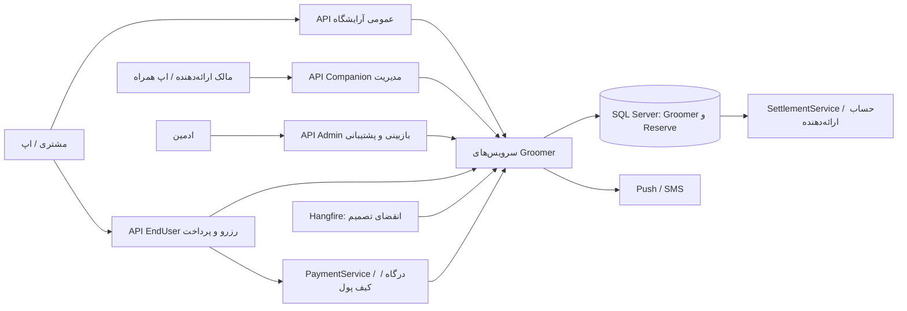
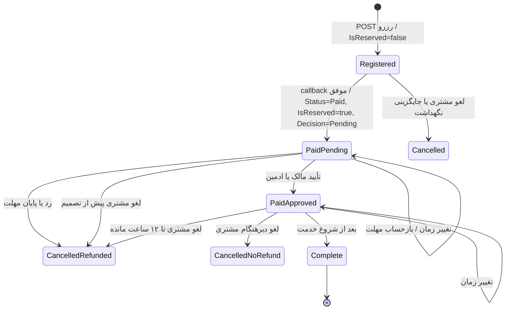
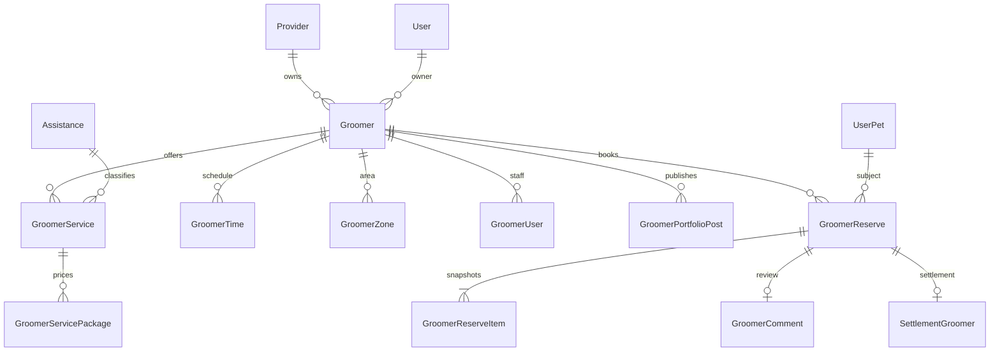

# معماری جامع آرایشگاه پاستیل (Groomer)

> مبنا: پیاده‌سازی موجود در کد بک‌اند تا ۲۷ مهر ۱۴۰۵ / ۱۹ اکتبر ۲۰۲۶. این سند رفتار فعلی کد را توضیح می‌دهد، نه وضعیت استقرار محیط تولید. قراردادهای عددی و مسیرهای API همین‌جا آمده‌اند؛ نام فایل‌های کد فقط برای ردگیری تغییرات است.

## ۱. مرز محصول و واژه‌ها

«آرایشگاه» (`Groomer`) واحد قابل جستجو و رزرو است؛ «ارائه‌دهنده» (`Provider`) هویت حقوقی/تسویه و صاحب حساب آن است؛ `OwnerId` کاربر مالک ارائه‌دهنده و مدیر آرایشگاه در API همراه است. این سه شناسه قابل جایگزینی با یکدیگر نیستند. هر آرایشگاه می‌تواند خدمات (`GroomerService`) داشته باشد؛ هر خدمت به یک `Assistance` فعال با `IsGrooming=true` متصل است و یک یا چند بستهٔ قیمت (`GroomerServicePackage`) دارد. رزرو برای **یک حیوان کاربر، یک آرایشگاه و حداکثر پنج بسته از خدمات متمایز** ساخته می‌شود. بستهٔ اول، بستهٔ اصلی رزرو است و هر بسته در `GroomerReserveItem` نیز ثبت می‌شود. رزرو در منزل یا سالن، با گزینهٔ دریافت/تحویل حیوان در حالت سالن، ممکن است. [منبع: `GroomerCoreService.cs:108-148`، `GroomerCatalogService.cs:57-101`، `GroomerReserveService.cs:601-625`]

مسیر اصلی مشتری: کشف آرایشگاه و نمونه‌کار → انتخاب بسته‌ها، حیوان و شیوهٔ خدمت → استعلام قیمت و ظرفیت → ثبت رزرو پرداخت‌نشده → تخفیف/کیف پول و پرداخت → انتظار تصمیم مالک → انجام خدمت → تکمیل → نظر و امتیاز. تصمیم رد یا انقضا، رزرو را لغو و مبلغ پرداخت‌شده را به کیف پول مشتری برمی‌گرداند. [منبع: `GroomerReserveService.cs:140-262,475-590`، `GroomerReserveApprovalService.cs:38-220`]

## ۲. سطوح دسترسی و مسئولیت

| سطح | داده و عمل | مرز امنیتی در کد |
|---|---|---|
| عمومی | جستجو/جزئیات آرایشگاه، خدمات و زمان‌ها، محدوده‌ها، تصاویر، نمونه‌کار و نظر تأییدشده | کنترلرهای `api/Groomer`, `api/GroomerPortfolio`, `api/GroomerReview` ناشناس‌اند؛ جستجوی عمومی فقط آرایشگاه فعال، تأییدشده و حذف‌نشده را برمی‌گرداند. `ShowToSite` پرچم نمایش وب است و فیلتر جستجوی API عمومی نیست. |
| مشتری دارای توکن | رزرو، قیمت/ظرفیت، پرداخت، تخفیف، کیف پول، لغو، نظر پس از تکمیل، لایک/نظر نمونه‌کار و پاسخ به دعوت همکاری | `BookerId` و `UserId` از توکن استخراج می‌شود؛ مشتری به رزرو شخص دیگر دسترسی ندارد. لیست مشتری سهم مالی/کمیسیون را صفر می‌کند. |
| مالک در Companion | ساخت/ویرایش آرایشگاه و خدمت/بسته، پرسنل، برنامه، محدوده، تصاویر و نمونه‌کار؛ بررسی و تکمیل رزروهای آرایشگاه خود؛ تاریخچهٔ تسویهٔ خود | علاوه بر `[Authorize]`، convention مرکزی سیاست `AreaMember:Companion` را اعمال می‌کند؛ سرویس نیز `OwnerId` را از کاربر توکن می‌سنجد. لیست رزرو فقط پرداخت‌شده‌های مالک را می‌دهد. شناسهٔ Provider ارسالی به مالک خارجی مجوز نمی‌دهد. |
| ادمین یا نقش دارای مجوز تفویض‌شده | ساخت/تأیید/رد/فعال‌سازی، تنظیم کمیسیون و دیده‌شدن، مدیریت رزرو و لغو با/بی استرداد، نظارت نظر و نمونه‌کار | convention مرکزی به همهٔ کنترلرهای Admin آرایشگاه policy `AdminArea` می‌افزاید: Admin با claim `RoleId` مجاز است؛ نقش دیگر فقط وقتی مجاز است که `OnTokenValidatedService` مجوز `RolePermission` همان controller/action را در همین درخواست تأیید کرده باشد. نام اکشن‌ها در `AdminPermissionCatalog` ثبت شده است. |

منابع: `Api/Controllers/GroomerController.cs:16-64`؛ `Api/Areas/EndUser/Controllers/GroomerReserveController.cs:13-82`؛ `Api/Areas/Companion/Controllers/GroomerReserveController.cs:13-65`؛ `Api/Authorization/AdminAreaAuthorizationConvention.cs:13-48`؛ `Api/Authorization/AdminAreaAuthorizationHandler.cs:13-43`؛ `Api/Program.cs:329-343`؛ `Application/Services/GroomerSrvs/GroomerSrv/GroomerCoreService.cs:108-187`؛ `Utility/Reflection/AdminPermissionCatalog.cs:210-212,283`.

## ۳. چرخهٔ انتشار، خدمات و پرسنل

1. در ساخت توسط ارائه‌دهنده، `ProviderId` به ارائه‌دهندهٔ خود کاربر حل و `OwnerId` از `Provider.UserId` تعیین می‌شود؛ `Approved=false`, `Active=false`, `ShowToSite=false`. ساخت توسط ادمین تأیید و فعال است اما `ShowToSite=false` باقی می‌ماند. ویرایش معمولی مالک، تأیید و فعال‌بودن و نمایش وب را پاک می‌کند و دوباره به بازبینی ادمین نیاز دارد. رد ادمین دلیل می‌خواهد؛ فعال‌سازی آرایشگاه تأییدنشده ممنوع است. [منبع: `GroomerCoreService.cs:108-148,191-299`]
2. خدمت به `Assistance` فعال با `IsGrooming=true` و همان آرایشگاه پیوند می‌خورد؛ خدمت ساخته‌شده توسط مالک نیازمند تأیید ادمین است. هر بسته نام، قیمت، پیش‌پرداخت، اندازهٔ حیوان و تصویر/توضیح اختیاری دارد. رزرو فقط بستهٔ فعال و خدمت فعال/تأییدشده در آرایشگاه فعال/تأییدشده را می‌پذیرد.

**جداسازی از کلینیک/نماینده:** خدمت گرومینگ (`Assistances.IsGrooming = true`) فقط برای آرایشگاه است. کلینیک/نماینده نمی‌تواند چنین خدمتی را بسازد یا به آن تغییر دهد (`CompanionAssistanceGroomingNotAllowed`)، در جستجو/جزئیات عمومی `CompanionAssistance` دیده نمی‌شود، و رزرو `CompanionReserve` روی آن رد می‌شود. `GET /api/Assistance` (عمومی، EndUser، Site) پیش‌فرض `IsGrooming=false` است؛ اپ آرایشگاه با `?IsGrooming=true` می‌گیرد و جستجوی سراسری هم این خدمات را برنمی‌گرداند. ادمین همه را می‌بیند. ردیف‌های قدیمی کلینیک‌ها با `scripts/DeactivateClinicGroomingServices.sql` غیرفعال می‌شوند.

**مخفی‌شدن آرایشگاه‌های منتقل‌شده:** Companionی که یک `Groomer` با `LegacyCompanionId` او وجود دارد و نوع دیگری (مثل کلینیک) ندارد، از لیست ادمین نمایندگی‌ها (به‌جز لیست ادمین نماینده‌ها با `IncludeMigratedGroomers` سمت سرور)، جستجوی عمومی نماینده/کلینیک، «نزدیک من» و جستجوی سراسری مخفی است. [منبع: `GroomerCatalogService.cs:57-101,195-287`؛ `GroomerReserveService.cs:673-683`]
3. پرسنل با شمارهٔ موبایل یک کاربر موجود دعوت می‌شوند. `UserAccept=null` یعنی دعوت باز، `true` یعنی پذیرفته، `false` یعنی ردشده؛ فرد ردشده می‌تواند دوباره دعوت شود. `StaffCount` فقط افراد فعالِ پذیرفته‌شده را می‌شمارد. انتساب فرد به خدمت و رزرو جداگانه است. [منبع: `GroomerProfileService.cs:40-170,339-342`]
4. برنامهٔ هفتگی با `WeekDay.Number` (شنبه ۱ تا جمعه ۷)، `HH:mm`، ظرفیت هر ردیف و بدون هم‌پوشانی ردیف‌های فعال یک روز تعریف می‌شود. جایگزینی برنامه ردیف‌های قبلی را نرم‌حذف می‌کند. حداکثر ۱۰۰ ردیف زمان و ۵۰۰ محدودهٔ خدمت پذیرفته می‌شود. [منبع: `GroomerReserveRules.cs:49-63`؛ `GroomerProfileService.cs:21-23,171-284`]
5. نمونه‌کار حداقل یک و حداکثر ۱۰ رسانهٔ موجود، کپشن حداکثر ۲۰۰۰ نویسه دارد. پست آرایشگاه تأییدشده هنگام ساخت `Approved=true` است و بعداً ادمین می‌تواند آن را پنهان کند؛ فید عمومی فقط پست و آرایشگاه فعال، تأییدشده و حذف‌نشده را می‌بیند. نظر نمونه‌کار تا ۱۰۰۰ نویسه و لایک هر کاربر برای هر پست یکتا است. [منبع: `GroomerPortfolioService.cs:21-23,38-75,146-178,193-379`]

## ۴. قرارداد API اصلی

همهٔ مسیرهای زیر زیر پیشوند `/api` هستند. کنترلرها عموماً نتیجهٔ کسب‌وکار را با HTTP 200 و `BaseResultDto` (`IsSuccess`, `Messages`, گاهی `Data`) بازمی‌گردانند؛ خطای احراز هویت در لایهٔ `[Authorize]` جداست. بنابراین کلاینت فقط به کد HTTP برای موفقیت عملیاتی تکیه نکند. [منبع: کنترلرهای آرایشگاه در `Api/Areas`]

| مخاطب | مسیر و فعل | ورودی/اثر اصلی |
|---|---|---|
| عمومی | `GET /Groomer`, `GET /Groomer/{id}` | جستجو/جزئیات قابل نمایش |
| عمومی | `GET /Groomer/{id}/Services`, `/Times`, `/Zones`, `/Pictures` | کاتالوگ، برنامه، محدوده، گالری |
| عمومی | `GET /GroomerPortfolio`, `GET /GroomerPortfolio/{id}`, `GET /GroomerPortfolio/Comments`, `GET /GroomerReview` | نمونه‌کار و نظر عمومی |
| مشتری | `GET /EndUser/GroomerReserve/Quote` | `packageIds` تکرارشونده یا `packageId` قدیمی، `pickupRequested`؛ `Price`, `OnlineAmount`, `PayAtVenue`, `DurationMinutes` |
| مشتری | `GET /EndUser/GroomerReserve/Availability` | `groomerId`, `date`, `packageId`, `extraPackageIds`, `assigneeUserId`؛ اسلات‌های `StartDate`, `Capacity`, `Available` |
| مشتری | `POST /EndUser/GroomerReserve` | ساخت رزرو با `GroomerReserveInputDto`؛ هنوز پرداخت نشده |
| مشتری | `GET /EndUser/GroomerReserve`, `GET /EndUser/GroomerReserve/{id}`, `PUT /EndUser/GroomerReserve/Cancel?id=` | لیست/جزئیات/لغو فقط رزرو خودش |
| مشتری | `PUT /EndUser/GroomerReservePayment/Rebate`, `DELETE .../Rebate?id=`, `PUT .../Wallet` | تنظیم/پاک کردن کد تخفیف و انتخاب کیف پول روی رزرو پرداخت‌نشدهٔ خود |
| مشتری | `POST /EndUser/GroomerReservePayment` | `PaymentStartDto.GroomerReserveId`؛ سرور `UserId` را از توکن بازنویسی می‌کند |
| مالک | `GET /Companion/GroomerReserve`, `GET .../{id}`, `PUT .../Approve?id=`, `PUT .../Reject`, `PUT .../Reschedule`, `PUT .../Complete?id=` | رزروهای پرداخت‌شدهٔ خود؛ رد دلیل می‌خواهد |
| ادمین | `GET /Admin/GroomerReserve`, `GET .../{id}`, `PUT .../Approve`, `/Reject`, `/Reschedule`, `/Complete`, `/Cancel?refund=true` | لغو ادمین دلیل می‌خواهد؛ `refund` پیش‌فرض true |
| مالک | `GET /Companion/GroomerSettlement`, `GET .../{id}`, `GET .../{id}/Items` | تاریخچه و ریز تسویهٔ ارائه‌دهندهٔ خود |

برای مدیریت پروفایل، خانوادهٔ کنترلرهای `/Companion/Groomer`, `GroomerService`, `GroomerSchedule`, `GroomerUser`, `GroomerPicture`, `GroomerPortfolio`, `GroomerReview` و معادل‌های Admin وجود دارد. دعوت پرسنل در `/EndUser/GroomerStaffInvite` و نظر پس از تکمیل در `POST /EndUser/GroomerReview` است. نام و فعل این مسیرها مستقیماً از attributeهای کنترلر تعیین می‌شود. [منبع: `Api/Areas/{Companion,Admin,EndUser}/Controllers/Groomer*Controller.cs`]

### بدنهٔ ساخت رزرو

`GroomerReserveInputDto`: `GroomerId`, `GroomerServicePackageId` (بستهٔ اصلی)، `ExtraPackageIds[]`, `UserPetId`, `DoDate`, `IsHomeService`, `AddressId?`, `PickupRequested`, `AssigneeUserId?`, `BookerNote?`. هویت مشتری در بدنه پذیرفته نمی‌شود و از توکن می‌آید. در منزل، آدرس متعلق به مشتری و داخل شهرِ محدودهٔ تعریف‌شده لازم است؛ اگر محدوده‌ای نباشد، شهر آدرس باید شهر آرایشگاه باشد. دریافت/تحویل برای خدمت در منزل پذیرفته نیست. [منبع: `GroomerReserveDto.cs:8-21`؛ `GroomerReserveService.cs:686-712`]

### قرارداد زمانی و ظرفیت

`DoDate` به دقیقه (ثانیه صفر) تبدیل می‌شود و باید حداقل یک ساعت بعد از ساعت سرور باشد. جمع مدت بسته‌ها نباید از ۷۲۰ دقیقه بگذرد و پایان در همان روز و در یک ردیف فعال ساعت کاری جا بگیرد. لیست زمان‌های آزاد با گام ۳۰ دقیقه تولید می‌شود. ظرفیت مؤثر `min(GroomerTime.Capacity, Groomer.MaxConcurrentPets)` است، مگر سقف آرایشگاه صفر/منفی باشد که فقط ظرفیت ردیف زمان ملاک است. تداخل بازه‌ها نیمه‌باز `[start,end)` است. رزرو پرداخت‌نشدهٔ تازه ۱۵ دقیقه ظرفیت را نگه می‌دارد؛ در callback پرداخت، ظرفیت دوباره با رزروهای پرداخت‌شده سنجیده می‌شود. تداخل فرد انتخاب‌شده و تداخل همان حیوان در رزروهای پرداخت‌شدهٔ همهٔ آرایشگاه‌ها رد می‌شود. [منبع: `GroomerReserveRules.cs:27-79`؛ `GroomerReserveService.cs:735-775`]

## ۵. ماشین حالت رزرو و تصمیم مالک

`Status` و `OwnerDecision` دو محور مستقل‌اند؛ `IsReserved` به معنی اعمال موفق پرداخت و `IsCancel` پرچم لغو است. برای UI هر چهار فیلد باید خوانده شود. [منبع: `GroomerReserve.cs:58-76`]

| فیلد | مقدارها و تفسیر |
|---|---|
| `Status` | `Registered=0`, `Paid=1`, `Complete=2`؛ لغو وضعیت چهارم نیست. |
| `OwnerDecision` | `NotRequired=0`, `Pending=1`, `Approved=2`, `Rejected=3`, `Expired=4`. |
| `OwnerApprovalDeadline` | در پرداخت: کمینهٔ «اکنون + ۱۲ ساعت» و «شروع نوبت − ۳۰ دقیقه»، اما حداقل «اکنون + ۳۰ دقیقه»؛ هنگام تغییر زمانِ رزرو Pending دوباره محاسبه می‌شود. |
| `RescheduleCount`, `OriginalDoDate`, `LastRescheduleDate` | تغییر زمان فقط روی رزرو پرداخت‌شدهٔ لغونشده و تکمیل‌نشده توسط مالک یا ادمین؛ زمان جدید متفاوت و حداقل یک ساعت آینده و دارای ظرفیت. نخستین زمان اصلی نگه داشته می‌شود. |

تأیید/رد فقط روی رزرو پرداخت‌شدهٔ لغونشده با تصمیم Pending انجام می‌شود. تکمیل به تصمیم Approved یا NotRequired، شروع‌شدن زمان و پرداخت موفق نیاز دارد. کد فعلی برای تغییر زمان، تأیید قبلی مالک را شرط نمی‌کند. [منبع: `GroomerReserveApprovalService.cs:38-60,229-237`؛ `GroomerReserveService.cs:266-331,568-590`]

## ۶. قرارداد مالی و استرداد

همهٔ مبالغ به واحد پول ذخیره‌شده در سامانه (در قواعد این ماژول «تومان») محاسبه می‌شوند؛ کلاینت نباید آن‌ها را دوباره بسازد. برای هر بسته، مبلغ آنلاین برابر پیش‌پرداخت است اگر `0 < PrePaymentPrice < Price`؛ در غیر این صورت کل قیمت بسته است. `Price = Σ Package.Price + PickupFee`؛ `OnlineAmount = Σ Deposit + PickupFee`؛ `PayAtVenue = Price − OnlineAmount`؛ پس از تخفیف `PaymentPrice = max(0, OnlineAmount − RebatePrice)`. کد تخفیف فقط به مبلغ آنلاین اعمال می‌شود؛ انتخاب کیف پول سقف `PaymentPrice` را مبنا می‌گیرد. [منبع: `GroomerReserveRules.cs:102-125,157-159`؛ `GroomerReserveService.cs:188-246,403-473`]

پرداخت با `PaymentType_GroomerReserve=33` و callback نوع `GroomerReserve` در `PaymentService` راه می‌افتد. در callback، تاریخ، فعال/تأیید بودن آرایشگاه و ظرفیت دوباره بررسی می‌شود؛ اگر پرداخت قابل اعمال نباشد، مسیر عمومی پرداخت باید جبران وجه درگاه را انجام دهد. بدهکارسازی کیف پول و مصرف کد تخفیف در مسیر اعمال موفق رخ می‌دهد. `PaymentPrice` مبنای سهم مالی، امتیاز خرید و استرداد رزرو است؛ صرفاً وجه درگاه نیست و ممکن است بخشی از آن از کیف پول آمده باشد. [منبع: `PaymentService.cs:1170-1240,1916-1918`؛ `GroomerReserveService.cs:489-556`]

کمیسیون خدمت در صورت مقدار مثبت بر پیش‌فرض آرایشگاه مقدم است؛ صفر به معنی استفاده از پیش‌فرض آرایشگاه است. `PaymentPrice` بین آیتم‌ها و هزینهٔ دریافت/تحویل بر اساس وزن مبلغ آنلاینشان تقسیم و هر بخش به تومان گرد می‌شود؛ بخش آخر باقیمانده را می‌گیرد. از سهم هر بخش، درصد سایت کم و مابقی سهم ارائه‌دهنده است. `ProviderShare + SiteShare = PaymentPrice`. ریز هر بسته در `GroomerReserveItem` و جمع در `GroomerReserve` snapshot می‌شود؛ تغییر قیمت/کمیسیون بعدی نباید گذشته را بازنویسی کند. [منبع: `GroomerReserveRules.cs:127-171`؛ `GroomerReserveService.cs:628-665`]

**لغو مشتری:** قبل از پرداخت فقط رزرو بسته می‌شود. پس از پرداخت، اگر تصمیم هنوز Pending باشد یا تا نوبت دست‌کم ۱۲ ساعت بماند، کل `PaymentPrice` به کیف پول برمی‌گردد؛ در لغو دیرتر پس از تصمیم، استردادی نیست. بعد از شروع یا تکمیل، مشتری حق لغو ندارد. **رد/انقضای تصمیم:** دلیل رد الزامی و استرداد کل مبلغ اجباری است. **لغو ادمین:** دلیل الزامی، `refund` اختیاری با پیش‌فرض true و حتی بعد از شروع، مادامی که تکمیل نشده، ممکن است. لغو و ثبت اعتبار کیف پول در تراکنش Serializable است؛ شکست استرداد، لغو را نیز rollback می‌کند. کلید دفتر `GroomerReserveRefund:{reserveId}` برای جلوگیری از تکرار استفاده می‌شود. [منبع: `GroomerReserveApprovalService.cs:89-220`]

تسویه فقط رزرو `IsReserved=true`, `IsCancel=false`, `Status=Complete` را می‌گیرد، از طریق `ProviderId` آرایشگاه به استخر Groomer ارائه‌دهنده وصل می‌کند، `Permitted` را علامت می‌زند و رابطهٔ یکتای `SettlementGroomer` می‌سازد. مشتری به دادهٔ سهم و تسویه دسترسی ندارد. امتیاز خرید در پرداخت `floor(PaymentPrice / 10000)` است و رویداد باشگاه پس از تکمیل ثبت می‌شود. [منبع: `SettlementSources.cs:43-47`؛ `SettlementService.cs:369-387`؛ `GroomerReserveService.cs:541-589`]

## ۷. مدل داده و قیود پایگاه داده

| موجودیت | فیلدها و قیدهای لازم برای توسعه |
|---|---|
| `Groomer` | `ProviderId?`, `OwnerId`, `Name`, شهر/استان، پرچم‌های `Approved/Active/Deleted/ShowToSite`, شیوهٔ خدمت و دریافت/تحویل، `MaxConcurrentPets`, `CommissionPercent`, `LegacyCompanionId?`. کد معرفی و شناسهٔ legacy در صورت وجود یکتا هستند. |
| `GroomerService` و `GroomerServicePackage` | خدمت به آرایشگاه و `Assistance` متصل است؛ بسته با `Price`, `PrePaymentPrice`, `PetSize`, `Active`, `Deleted` رزروشدنی بودن را تعیین می‌کند. |
| `GroomerTime`, `GroomerZone`, `GroomerUser` | زمان هفتگی و ظرفیت، محدودهٔ شهر، و دعوت/پذیرش کاربر از هم مستقل‌اند. |
| `GroomerReserve` | کد رزرو یکتای حداکثر ۴۰ نویسه، مالک حیوان/خریدار، زمان شروع/پایان، شیوه و نشانی، مبالغ snapshot، وضعیت/تصمیم، تاریخ‌ها و تغییر زمان. قید DB: `EndDate >= DoDate` و `Price`, `OnlineAmount`, `PaymentPrice`, `WalletPrice`, `RebatePrice` نامنفی. اندیس زمان/آرایشگاه، خریدار/تاریخ ساخت، تصمیم/مهلت دارد. |
| `GroomerReserveItem` | یک سطر برای هر بسته با قیمت، مبلغ آنلاین، مدت و سهم‌های snapshot. |
| `GroomerComment` و `SettlementGroomer` | `GroomerReserveId` نظر در صورت وجود یکتا؛ `SettlementGroomer.GroomerReserveId` یکتا است تا یک رزرو دوبار تسویه نشود. |
| `GroomerPortfolioPost/Picture/Like/Comment` | پست و رسانه/تعاملات، با یکتایی لایک `(PostId,UserId)` و شمارنده‌های محاسبه‌شده. |

قیود و رابطه‌ها در `Persistence/Context/GroomerModelConfiguration.cs` تعریف شده‌اند. مهاجرت‌ها به ترتیب `20261019085911_AddGroomers` (هسته و کاتالوگ)، `20261019111501_AddGroomerReserves` (رزرو/تسویه/کدهای پرداخت و اعلان)، `20261019120720_AddGroomerPhase3` (آیتم‌های چندخدمتی، دعوت، تغییر زمان، امتیاز و اعلان‌ها)، `20261019122523_AddAssistanceIsGrooming` (علامت خدمت آرایش) هستند. فایل مهاجرت یا اسکریپت SQL **اثبات اجرا در محیط تولید نیست**؛ پیش از اتکا به این مدل در هر محیط، تاریخچهٔ migration و اسکیمای همان محیط باید بررسی شود.

## ۸. نظر، اعلان و کارهای پس‌زمینه

نظر آرایشگاه فقط توسط خریدار رزرو پرداخت‌شده و تکمیل‌شده، یک بار برای هر رزرو، با امتیاز ۱ تا ۵ و متن ۱ تا ۱۰۰۰ نویسه ثبت می‌شود. ابتدا در وضعیت منتظر بررسی است؛ جستجوی عمومی فیلتر وضعیت ورودی را نادیده می‌گیرد و فقط نظرهای تأییدشدهٔ آرایشگاه فعال/تأییدشده را می‌دهد. ادمین قبول/رد می‌کند و امتیاز و شمارندهٔ آرایشگاه دوباره محاسبه می‌شود؛ مالک یا ادمین می‌توانند پاسخ دهند. [منبع: `GroomerReviewService.cs:85-214`]

اعلان پوش/پیامک برای تصمیم آرایشگاه، پرداخت رزرو و نیاز به تأیید، تأیید/رد/انقضا، لغو مشتری/ادمین، تغییر زمان و دعوت پرسنل پیاده شده است. این اعلان‌ها اثر جانبی‌اند؛ نبود تنظیمات SMS یا خطای ارسال ممکن است صرفاً ثبت خطا شود، پس نتیجهٔ پرداخت/رزرو را از «تحویل اعلان» نتیجه‌گیری نکنید. کار Hangfire با شناسهٔ `GroomerReserveExpireOverdue` هر ۵ دقیقه حداکثر ۱۰۰ رزرو Pending مهلت‌گذشته را در هر اجرا برای لغو و استرداد بررسی می‌کند. [منبع: `GroomerNotifier.cs:21-232`؛ `GroomerReserveApprovalService.cs:62-87`؛ `Api/Program.cs:604-608`]

## ۹. قواعد تغییر کد برای تیم آینده

- مبالغ و وضعیت را از snapshot رزرو بخوانید؛ از قیمت زندهٔ بسته برای تاریخچه، استرداد یا تسویه استفاده نکنید.
- تغییر ظرفیت/زمان/تخفیف و callback پرداخت باید قواعد Serializable و بازبینی ظرفیت هنگام callback را حفظ کند. `[start,end)` و نگهداشت ۱۵ دقیقه‌ای بخشی از قراردادند.
- `Status=Paid` به‌تنهایی به معنی رزرو قابل اجرا نیست: `IsReserved`, `IsCancel`, `OwnerDecision` و `OwnerApprovalDeadline` را نیز لحاظ کنید.
- در UI مشتری `PayAtVenue` را جدا از مبلغ آنلاین نشان دهید؛ تضمین پرداخت حضوری در همین ماژول ثبت نشده است.
- اعلان را رویداد آگاهی‌رسانی بدانید؛ وضعیت نهایی را از API و DB بخوانید.
- تغییر قرارداد API یا enumها نیازمند هماهنگی هم‌زمان کلاینت Flutter، وب، تست و migration است.

## ۱۰. نشانگرهای پیاده‌سازی

هسته: `Application/Services/GroomerSrvs/GroomerSrv/GroomerCoreService.cs`؛ کاتالوگ: `GroomerCatalogSrv/GroomerCatalogService.cs`؛ پروفایل: `GroomerProfileSrv/GroomerProfileService.cs`؛ رزرو: `GroomerReserveSrv/GroomerReserveService.cs`, `GroomerReserveApprovalService.cs`, `GroomerReserveRules.cs`؛ نمونه‌کار و نظر: `GroomerPortfolioSrv/GroomerPortfolioService.cs`, `GroomerReviewSrv/GroomerReviewService.cs`؛ پرداخت: `Application/Services/Order/PaymentSrv/PaymentService.cs`؛ تسویه: `Application/Services/FinanceSrvs/SettlementSrv`؛ نگاشت DB: `Persistence/Context/GroomerModelConfiguration.cs`. این نشانی‌ها برای ممیزی تغییرات‌اند و برای فهم قرارداد این سند لازم نیستند.
