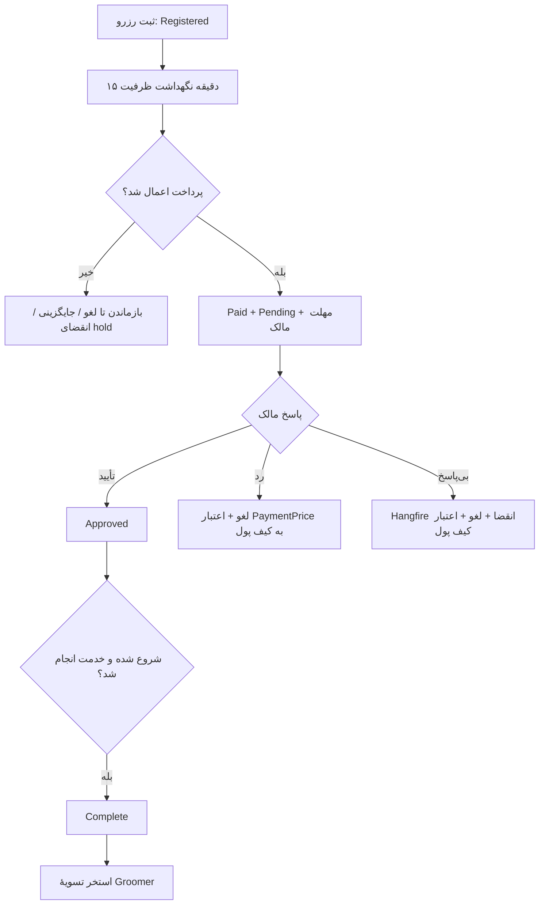

# عملیات، انتشار و آزمون آرایشگاه پاستیل

> مبنا: کد فعلی بک‌اند در ۱۹ اکتبر ۲۰۲۶. وجود فایل migration، اسکریپت یا تست به معنی اجرای آن در production نیست. این راهنما به‌تنهایی برای آماده‌سازی محیط، پایش، رسیدگی به خطا و برنامهٔ QA ماژول آرایشگاه قابل استفاده است.

## ۱. شرایط آماده‌سازی محیط

### ترتیب داده و اسکیمای لازم

| ترتیب | تغییر اسکیمایی | اثر قابل بررسی |
|---:|---|---|
| ۱ | `20261019085911_AddGroomers` | جدول آرایشگاه و وابسته‌های کاتالوگ، برنامه، پرسنل، محدوده، گالری، نمونه‌کار و نظر |
| ۲ | `20261019111501_AddGroomerReserves` | `GroomerReserves`, `SettlementGroomers`, پیوند کیف پول/نظر به رزرو و کدهای نوع پرداخت/تخفیف/پوش |
| ۳ | `20261019120720_AddGroomerPhase3` | `GroomerReserveItems`, `GroomerUsers.InviteDate` (ستون `UserAccept` از `AddGroomers` وجود داشت), فیلدهای تغییر زمان و داده‌های امتیاز/پوش؛ یک آیتم برای رزروهای قدیمی backfill می‌شود |
| ۴ | `20261019122523_AddAssistanceIsGrooming` | ستون `Assistance.IsGrooming` برای تشخیص خدمت قابل افزودن به آرایشگاه |

منبع: فایل‌های همین نام در `Persistence/Migrations`. در هر محیط، پیش از راه‌اندازی قابلیت، آخرین migration واقعی را از `__EFMigrationsHistory` و ستون‌ها/اندیس‌های موجود را از خود پایگاه داده بخوانید. اسکریپت‌های `scripts/AddGroomers.sql`, `AddGroomerReserves.sql`, `AddGroomerPhase3.sql`, `AddAssistanceIsGrooming.sql` مسیر جایگزین اجرای DDL هستند و نباید بدون بررسی تاریخچه هم‌زمان با EF migration اجرا شوند. `scripts/MigrateCompanionGroomersToGroomers.sql` انتقال دادهٔ قدیمی و `scripts/SeedGroomerSms.sql` الگوهای پیامک را هدف می‌گیرند؛ اجرای خودکارشان از صرف وجود فایل نتیجه نمی‌شود.

پیش‌نیازهای عملیاتی: ارائه‌دهندهٔ معتبر برای هر آرایشگاه، `Assistance` فعال با `IsGrooming=true` برای ساخت خدمت، بستهٔ فعال با قیمت معتبر، ساعت کاری فعال و ظرفیت، کد `PaymentType_GroomerReserve` و `RebateType_GroomerReserve` در جدول کدها، تنظیم درگاه/کیف پول، و در صورت نیاز تنظیمات Push/SMS. تسویه به `ProviderId` آرایشگاه و حساب/کارت معتبر ارائه‌دهنده متکی است. [منبع: `GroomerCoreService.cs:108-148`؛ `GroomerCatalogService.cs:57-101`؛ `GroomerReserveService.cs:673-775`؛ `PaymentService.cs:1170-1233`؛ `SettlementService.cs:369-387`]

### وارسی پس از انتشار

1. نسخهٔ API و اسکیمای DB یک محیط را با هم تطبیق دهید؛ حضور چهار migration بالا، ستون `GroomerReserveItems`, `OwnerApprovalDeadline`, `UserAccept`, `InviteDate`, `IsGrooming` و کدهای پرداخت/تخفیف/اعلان را بررسی کنید.
2. با دادهٔ آزمایشی غیرفعال، مسیر عمومی جستجو و فیلتر آرایشگاه تأییدنشده را بررسی کنید؛ `ShowToSite` را برای وب جداگانه بسنجید، زیرا جستجوی API عمومی به این پرچم متکی نیست. [منبع: `GroomerCoreService.cs:157-187,318-326`]
3. Hangfire را از نظر ثبت و اجرای `GroomerReserveExpireOverdue` و `PaymentReconcileUnconfirmed` بررسی کنید؛ هر دو هر پنج دقیقه زمان‌بندی شده‌اند. [منبع: `Api/Program.cs:557-558,604-608`]
4. یک رزرو آزمایشی با درگاه/کیف پول مناسب بسازید و پس از callback، `Status=Paid`, `IsReserved=true`, `OwnerDecision=Pending`, `PaidDate`, `OwnerApprovalDeadline` و `ProviderShare+SiteShare=PaymentPrice` را ببینید. سپس با تأیید و تکمیل، ورود به استخر تسویه را کنترل کنید. [منبع: `GroomerReserveService.cs:489-589`؛ `SettlementSources.cs:43-47`]
5. ارسال Push/SMS را جداگانه بسنجید؛ خطای اعلان نباید به‌عنوان شکست تراکنش یا تضمین تحویل تعبیر شود. [منبع: `GroomerNotifier.cs:21-232`]


### ترتیب راه‌اندازی جداسازی گرومینگ از کلینیک و پیامک
1. اجرای `AddAssistanceIsGrooming` (migration یا `scripts/AddAssistanceIsGrooming.sql`).
2. در پنل، خدمات گرومینگ را با تیک «خدمت گرومینگ» علامت بزنید (`Assistances.IsGrooming = 1`). تا این کار انجام نشود، آرایشگاه نمی‌تواند خدمت بسازد (`GroomerServiceNotGrooming`).
3. `scripts/DeactivateClinicGroomingServices.sql` را اول با `@Commit = 0` و بعد `1` اجرا کنید؛ ردیف‌های گرومینگِ کلینیک/نماینده (`CompanionAssistances`) فقط غیرفعال می‌شوند، حذف نمی‌شوند و رزروهای قبلی دست‌نخورده می‌مانند.
4. `scripts/SeedGroomerSms.sql` را اجرا کنید (۱۲ ردیف `MessageTypes` و `SmsSettings`). بدون این ردیف‌ها پیامکی ارسال نمی‌شود.
5. ۱۲ قالب Lookup را در کاوه‌نگار بسازید؛ نام قالب برابر `MessageTypes.Label` است (مثل `GroomerReserveForUser`، بدون زیرخط). متن قالب‌ها در `backend/Docs/GROOMER_FA.md` و `SeedGroomerSms.sql` است.
6. توکن‌ها: کاوه‌نگار فقط `%token`، `%token2`، `%token3`، `%token10` و `%token20` را می‌پذیرد. کد، چهارمین مقدار را به `token10` می‌فرستد؛ پس در قالب‌هایی که چهار مقدار دارند (ثبت رزرو به کاربر و به آرایشگاه، تأیید رزرو، تغییر زمان به کاربر) مقدار چهارم باید `%token10` نوشته شود. فاصله و نیم‌فاصله در توکن‌ها توسط کد جایگزین می‌شود.
7. وقتی قالب ساخته یا تأیید نشده باشد پوش کار می‌کند ولی پیامک نمی‌رود؛ خطا فقط لاگ می‌شود و رزرو را خراب نمی‌کند.

## ۲. قواعد عددی مرجع برای عملیات و QA

این مقدارها از `GroomerReserveRules.cs:25-198`, `GroomerProfileService.cs:21-23` و `GroomerPortfolioService.cs:21-23` آمده‌اند:

| ثابت/قاعده | مقدار یا فرمول | اثر قابل مشاهده |
|---|---|---|
| `MaxPackages` | ۵ | رزرو ششمین بسته را رد می‌کند؛ دو بسته از یک خدمت نیز رد می‌شود. |
| `MaxTotalMinutes` | ۷۲۰ دقیقه | مجموع مدت بسته‌ها بیشتر از ۱۲ ساعت رد می‌شود. |
| `DefaultDurationMinutes` | ۶۰ دقیقه | اگر مدت خدمت مثبت نباشد. |
| `SlotStepMinutes` | ۳۰ دقیقه | فاصلهٔ آغاز زمان‌های پیشنهادی. |
| `MinLead` | ۱ ساعت | ساخت و تغییر زمان باید دست‌کم یک ساعت جلوتر از ساعت سرور باشند. |
| `UnpaidHold` | ۱۵ دقیقه | رزرو پرداخت‌نشدهٔ تازه ظرفیت را در مرحلهٔ ساخت اشغال می‌کند. |
| `DecisionWindow` | ۱۲ ساعت | مهلت پایهٔ تصمیم مالک پس از پرداخت. |
| `StartBuffer` / `MinWindow` | ۳۰ / ۳۰ دقیقه | سقف مهلت تا ۳۰ دقیقه قبل از شروع، کف مهلت ۳۰ دقیقه پس از پرداخت. |
| `FreeCancelWindow` | ۱۲ ساعت | لغو مشتری تا این فاصله از شروع با استرداد، همچنین تا قبل از تصمیم مالک. |
| `MaxTimeRows`, `MaxZones`, `MaxPictures` | ۱۰۰، ۵۰۰، ۳۰ | سقف برنامه، محدوده و تصاویر پروفایل. |
| نمونه‌کار | ۱ تا ۱۰ رسانه، کپشن ≤۲۰۰۰، نظر ≤۱۰۰۰ نویسه | اعتبارسنجی انتشار و تعامل. |
| نظر پس از رزرو | نرخ ۱ تا ۵، متن ۱ تا ۱۰۰۰ نویسه | فقط خریدار رزرو تکمیل‌شده، یک بار. |
| امتیاز خرید | `floor(PaymentPrice/10000)` | پس از اعمال موفق پرداخت. |

فرمول مالی: `Deposit(package)=PrePaymentPrice` اگر بین صفر و قیمت باشد، وگرنه `Price`؛ `OnlineAmount=ΣDeposit+PickupFee`؛ `Price=ΣPackagePrice+PickupFee`؛ `PayAtVenue=Price−OnlineAmount`؛ `PaymentPrice=max(0,OnlineAmount−RebatePrice)`. سهم سایت و ارائه‌دهنده از **کل `PaymentPrice`** محاسبه می‌شود؛ `WalletPrice` فقط سهم پرداخت‌شده از کیف پول را نشان می‌دهد. [منبع: `GroomerReserveRules.cs:102-171`؛ `PaymentService.cs:1195-1225`]

## ۳. فرایند عملیاتی رزرو و جدول تصمیم



| وضعیت | اقدام مجاز/نامجاز | خروجی مالی |
|---|---|---|
| `Registered`, `IsReserved=false` | تخفیف/کیف پول/پرداخت و لغو مشتری؛ callback دوباره ظرفیت را بررسی می‌کند. | هنوز وصول موفق ثبت نشده است. |
| `Paid`, `Pending` | مالک/ادمین تأیید، رد، یا تغییر زمان؛ مشتری پیش از شروع لغو می‌کند؛ job پس از مهلت منقضی می‌کند. | رد، انقضا و لغو مشتری در Pending کل `PaymentPrice` را به کیف پول برمی‌گرداند. |
| `Paid`, `Approved` | تغییر زمان مالک/ادمین؛ تکمیل پس از شروع؛ لغو مشتری تا شروع. | لغو در فاصلهٔ ≥۱۲ ساعت با استرداد، نزدیک‌تر بدون استرداد. |
| `Complete` | نظر خریدار و ورود به تسویه؛ لغو و تکمیل مجدد رد می‌شود. | فقط رزرو کامل، پرداخت‌شده و لغونشده قابل تسویه است. |
| `IsCancel=true` | در همهٔ وضعیت‌ها از ظرفیت و تسویه کنار می‌رود. | مقدار استرداد را از ledger بخوانید، نه از پرچم لغو. |

`Status` فقط `Registered=0`, `Paid=1`, `Complete=2` دارد؛ رد/انقضا در `OwnerDecision` (`Rejected=3`, `Expired=4`) و `IsCancel` ثبت می‌شود. `OwnerDecision` در زمان ساخت `NotRequired=0` و پس از پرداخت `Pending=1` است. [منبع: `GroomerReserveRules.cs:7-22`؛ `GroomerReserveService.cs:216-255,489-590`]

## ۴. رسیدگی به حادثه و پایش

### پرداخت موفق درگاه، رزرو هنوز پرداخت‌نشده

`GroomerReserveId`، `BookerId`، ردیف Payment با `CallBackTypeLabel=GroomerReserve` و شناسهٔ callback، وضعیت تراکنش درگاه، مبالغ snapshot (`PaymentPrice`, `RebatePrice`, `WalletPrice`) و `IsCancel/DoDate` را کنار هم بررسی کنید. سیستم در callback مالکیت، snapshot، زمان آینده، فعال/تأیید بودن آرایشگاه و ظرفیت را دوباره می‌سنجد. `PaymentReconcileUnconfirmed` هر پنج دقیقه پرداخت تأییدنشده را پیگیری می‌کند. اگر وجه درگاه گرفته شده ولی اعمال هدف ناممکن باشد، مسیر جبران وجه درگاه به کیف پول با دفتر `PaymentRefund:{paymentId}` طراحی شده است. به‌صورت دستی callback را بدون بررسی ledger و هدف تکرار نکنید. [منبع: `PaymentService.cs:789-812,1170-1233,1734-1747,1916-1918`؛ `GroomerReserveService.cs:489-556`؛ `Api/Program.cs:557-558`]

### رزرو Pending و مهلت گذشته

ساعت سرور، `OwnerApprovalDeadline`, `OwnerDecision`, `IsReserved`, `IsCancel` و سلامت Hangfire را وارسی کنید. job هر اجرا ۱۰۰ شناسهٔ قدیمی‌تر را برمی‌دارد و برای هر مورد لغو + استرداد را در تراکنش Serializable انجام می‌دهد؛ خطا ثبت می‌شود و مورد باقی‌مانده در اجرای بعدی دوباره قابل انتخاب است. اگر `GroomerReserveRefund:{reserveId}` قبلاً موجود است، نباید اعتبار دوباره صادر شود. [منبع: `GroomerReserveApprovalService.cs:62-87,160-220`]

### اختلاف مبلغ، کیف پول یا تسویه

برای رزرو، `Price`, `OnlineAmount`, `RebatePrice`, `PaymentPrice`, `WalletPrice`, `ProviderShare`, `SiteShare` و `GroomerReserveItems` را بخوانید. شرایط مورد انتظار: `PaymentPrice=max(0,OnlineAmount−RebatePrice)`, `ProviderShare+SiteShare=PaymentPrice`, و مجموع سهم آیتم‌ها به‌اضافهٔ سهم هزینهٔ دریافت/تحویل برابر جمع رزرو باشد. اگر استرداد رزرو انجام شده، دفتر `GroomerReserveRefund:{reserveId}` باید یکتا و به نفع همان `BookerId` باشد. رزرو لغو یا ناتمام نباید `Permitted=true` و `SettlementGroomer` جدید بگیرد. [منبع: `GroomerReserveService.cs:628-665`؛ `GroomerReserveApprovalService.cs:201-219`؛ `SettlementSources.cs:43-47`؛ `SettlementService.cs:369-387`]

### شکایت «زمان آزاد بود ولی پرداخت نشد»

استعلام Availability یک لحظه از وضعیت ظرفیت است؛ ثبت رزرو در تراکنش Serializable دوباره ظرفیت را می‌سنجد و callback پرداخت نیز با رزروهای پرداخت‌شده بازبینی می‌کند. تغییر وضعیت آرایشگاه، پرشدن ظرفیت، تداخل پرسنل یا همان حیوان، و گذشتن زمان نوبت می‌تواند سبب عدم اعمال شود. شناسهٔ `GroomerTime`، بازهٔ `[DoDate,EndDate)`, ظرفیت مؤثر و رزروهای هم‌پوشان را بررسی کنید. نگهداشت پرداخت‌نشده فقط تا ۱۵ دقیقه در ساخت رزرو اثر دارد، نه در callback. [منبع: `GroomerReserveService.cs:192-214,489-514,735-775`]

### معیارهای پایش پیشنهادی

این‌ها **قرارداد SLO پیاده‌شده نیستند**؛ پیشنهاد پایش‌اند: تعداد رزروهای Pending با مهلت گذشته، تعداد و سن پرداخت‌های تأییدنشده، خطاهای `GroomerReserveExpireOverdue`, نرخ شکست callback، اختلاف `ProviderShare+SiteShare` با `PaymentPrice`, استردادهای فاقد ledger، تعداد رزرو کاملِ تسویه‌نشده، و شکست ارسال اعلان. برای سنجش کیفیت، نام رویدادها و خطاها در `GroomerReserveService`, `GroomerReserveApprovalService`, `PaymentService`, `GroomerNotifier` لاگ می‌شوند.

## ۵. ماتریس QA قبل از انتشار

| حوزه | سناریوهای مثبت | سناریوهای مرزی/منفی و نتیجهٔ لازم |
|---|---|---|
| هویت و دامنه | مالک آرایشگاه خود را می‌سازد؛ Admin یا نقش دارای `RolePermission` همان اکشن با policy مرکزی `AdminArea` عمل می‌کند؛ مشتری فقط رزرو خود را می‌بیند. | `ProviderId` خارجی، ویرایش/تصمیم مالک دیگر، `BookerId` جعلی، ورود بدون عضویت `AreaMember:Companion` و دیدن سهم مالی از لیست مشتری باید رد/پنهان شوند. |
| کاتالوگ | خدمت Grooming و بستهٔ فعال بعد از تأیید عمومی و قابل رزرو است. | `Assistance.IsGrooming=false`, بسته/خدمت غیرفعال یا حذف‌شده، قیمت یا سایز نامعتبر، خدمت تکراری در رزرو رد شود. |
| برنامه/پرسنل | ساعت هفتگی و ظرفیت، دعوت و پذیرش پرسنل، فرد منتخب معتبر. | بازهٔ زمانی هم‌پوشان، بیش از ۱۰۰ ردیف/۵۰۰ محدوده، کارمند ردکننده/غیرفعال، تعارض کارمند در دو رزرو هم‌زمان رد شود. |
| رزرو | یک تا پنج بسته از خدمات مجزا، حیوان متعلق به کاربر، سالن/منزل مجاز، snapshot قیمت و کد رزرو. | شروع کمتر از یک ساعت، عبور از روز/ساعت کار، مجموع مدت >۷۲۰، سایز/نوع حیوان نامعتبر، آدرس غیرمتعلق یا خارج شهر، Pickup در منزل، ظرفیت پر و حیوان هم‌زمان رد شود. |
| رقابت ظرفیت | دو درخواست هم‌زمان برای آخرین ظرفیت؛ یکی موفق. | نگهداشت پرداخت‌نشده بعد از ۱۵ دقیقه ظرفیت را اشغال نکند؛ callback بعد از پرشدن ظرفیت یا غیرفعال شدن آرایشگاه رزرو را Paid نکند. |
| پرداخت | تخفیف فقط OnlineAmount را کم کند؛ کیف پول تمام/بخشی از مبلغ؛ callback Status/decision/کمیسیون را ثبت کند. | پرداخت دوباره، snapshot دستکاری‌شده، callback تکراری، نوبت گذشته، کیف پول ناکافی، خطای callback و جبران وجه درگاه بدون دوباراعتبار بررسی شود. |
| تصمیم/لغو | تأیید Pending؛ رد با دلیل و استرداد؛ job انقضا؛ لغو مشتری در Pending یا ≥۱۲ ساعت مانده. | رد بدون دلیل، تصمیم روی غیر Pending، لغو پس از شروع، لغو Complete، استرداد دوباره، شکست Wallet و rollback لغو، لغو دیرهنگام بدون استرداد. |
| تغییر زمان/تکمیل | مالک/ادمین زمان آزاد را انتخاب کند؛ مهلت Pending بازحساب؛ پس از شروع و تأیید تکمیل شود. | زمان برابر/کمتر از یک ساعت/پر، تغییر زمان رزرو لغو یا کامل، تکمیل زودهنگام یا بدون تأیید رد شود. |
| محتوا | پست قابل نمایش، لایک یکتا، نظر رزرو کامل پس از تأیید ادمین عمومی شود. | پست بی‌رسانه/بیش از ۱۰، نظر تکراری یا از غیرخریدار، وضعیت بررسی‌نشده در API عمومی و آرایشگاه غیرفعال پنهان شود. |
| تسویه | فقط Complete و غیرلغو، یک بار به استخر Groomer همان Provider وارد شود. | آرایشگاه با Provider خارجی، کارت نامعتبر، رزرو تغییرکرده در میانهٔ تراکنش، تسویهٔ دوباره یا نمایش تسویهٔ دیگران رد شود. |

### آزمون‌های موجود و اجرای هدفمند

پروژهٔ `Application.Tests/Application.Tests.csproj` آزمون‌های `GroomerReserveRulesTests`, `GroomerReserveServiceTests`, `GroomerReserveApprovalTests`, `GroomerPhase3Tests`, `GroomerCoreServiceTests`, `GroomerCatalogServiceTests`, `GroomerProfileServiceTests`, `GroomerPortfolioServiceTests`, `GroomerReviewServiceTests`, `GroomerSettlementTests` را دارد. این‌ها قواعد خالص، سرویس با دیتابیس محلی و سناریوهای مالی/تسویه را می‌پوشانند؛ جای آزمون end-to-end درگاه واقعی و Push/SMS واقعی را نمی‌گیرند. [منبع: `Application.Tests/Groomer/*.cs`]

```powershell
dotnet test Application.Tests/Application.Tests.csproj --filter FullyQualifiedName~Groomer
```

در وارسی محلی این نسخه در ۱۹ اکتبر ۲۰۲۶، همین فیلتر با `--no-restore` اجرا شد: **۱۱۲ آزمون موفق، صفر شکست، بدون هشدار یا خطای build**. این نتیجه مربوط به checkout محلی است و وضعیت محیط production را نشان نمی‌دهد.

برای تأیید قرارداد API موبایل/وب، اجرای end-to-end با هویت واقعی سه نقش و DB هم‌نسخهٔ API لازم است. نتیجهٔ آزمون‌ها باید همراه commit کد، نسخهٔ migration و محیط اجرا ثبت شود؛ صرف سبزشدن تست محلی وضعیت production را اثبات نمی‌کند.

## ۶. نقاط حساس شناخته‌شده در رفتار فعلی

- `ShowToSite` توسط تنظیم ادمین کنترل می‌شود، ولی `SearchPublic` صرفاً تأیید/فعال‌بودن را اعمال می‌کند؛ وب باید سیاست نمایش موردنظر را آگاهانه پیاده کند. [منبع: `GroomerCoreService.cs:157-187,318-326`]
- تغییر زمان توسط مالک/ادمین برای رزرو Paid با تصمیم Pending نیز مجاز است؛ اگر مالک تصمیم هنوز نگرفته، مهلت پاسخ با زمان جدید تغییر می‌کند. [منبع: `GroomerReserveService.cs:266-324`]
- بازپرداخت رزرو `PaymentPrice` را به کیف پول می‌دهد، نه الزاماً همان مبلغ خروجی از درگاه؛ چون بخشی ممکن است از کیف پول تأمین شده باشد. جبران پرداخت درگاهِ تأییدشده ولی اعمال‌نشده یک ledger جدا با نام `PaymentRefund:{paymentId}` است. این دو را در گزارش مالی مخلوط نکنید. [منبع: `GroomerReserveApprovalService.cs:201-219`؛ `PaymentService.cs:789-812`]
- API عمدتاً خطاهای کسب‌وکار را در بدنهٔ پاسخ HTTP 200 برمی‌گرداند. Flutter و وب باید `IsSuccess` را بخوانند و متن `Messages` را نشان دهند؛ وضعیت نهایی رزرو را بعد از بازگشت از درگاه مجدداً از API دریافت کنند. [منبع: کنترلرهای `GroomerReserveController.cs` و `GroomerReservePaymentController.cs`]
- ارسال اعلان best effort است؛ صحت جریان را از رکورد رزرو، Payment و Wallet به دست آورید. [منبع: `GroomerNotifier.cs`؛ `GroomerReserveService.cs:858`]
