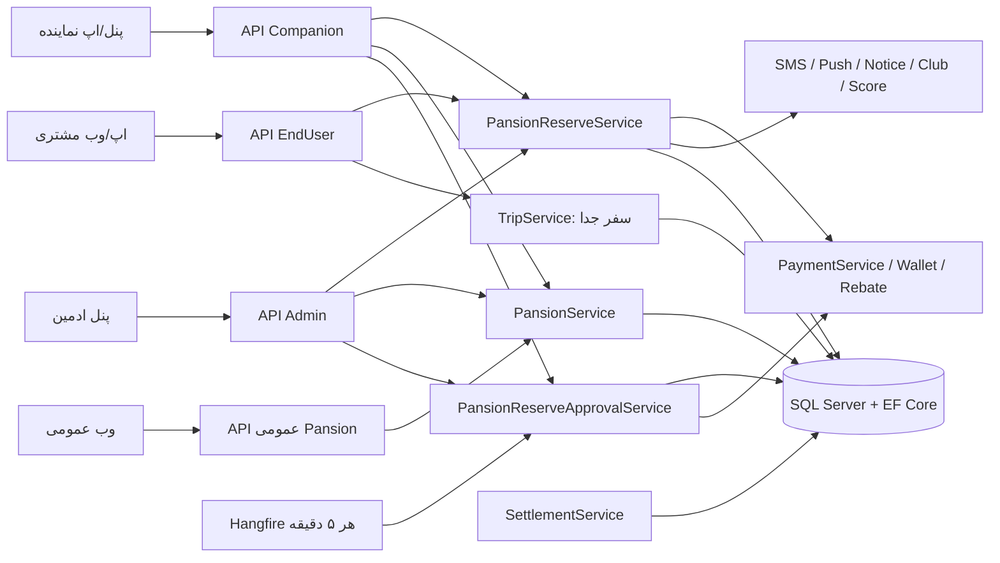
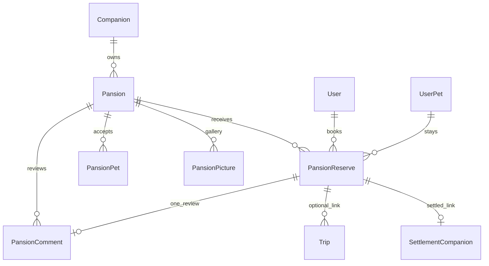
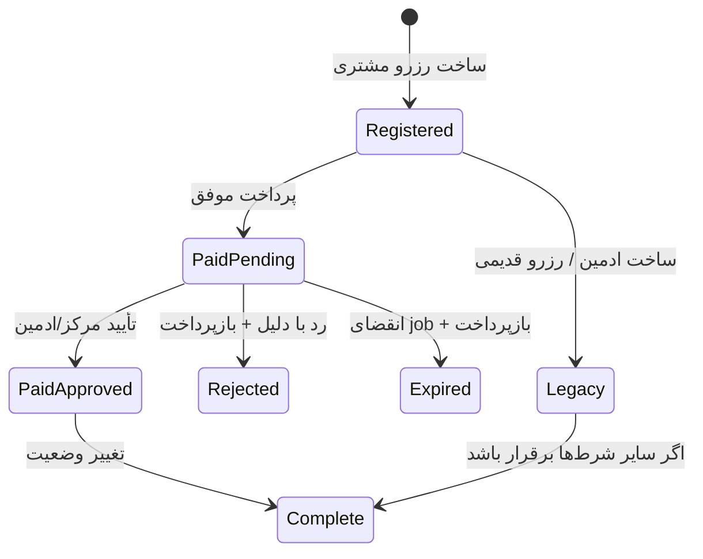

# معماری و قرارداد اجرایی پانسیون و مهد پت پاستیل

**مبنای این سند:** کد موجود در ورک‌اسپیس در ۲۸ مهر ۱۴۰۵ (۲۰ اکتبر ۲۰۲۶). «پانسیون» در نام کلاس‌ها و مسیرهای API هر دو نوع خدمت را پوشش می‌دهد: اقامت شبانه و مهد ساعتی. این متن رفتار پیاده‌سازی‌شده را توضیح می‌دهد؛ وجود migration در مخزن به‌تنهایی گواه اجرای آن روی دیتابیس یا انتشار نسخهٔ Production نیست.

## ۱. مرز دامنه و واژه‌ها

| مفهوم | قرارداد در کد |
|---|---|
| `Pansion` | مرکز نگهداری متعلق به یک `Companion`. نوع آن با `IsDaycare` مشخص می‌شود. `false` یعنی اقامت شبانه؛ `true` یعنی مهد ساعتی. مقدار `null` برای رکورد قدیمی ممکن است، ولی درخواست ساخت/ویرایش جدید **و رزرو هر دو حالت** رد می‌شود. توضیح داخل entity که `false/null` را اقامت می‌خواند با validator فعلی رزرو سازگار نیست. |
| `PansionReserve` | رزرو یک `UserPet` توسط `Booker`. برای مهد تاریخ و بازهٔ ساعت؛ برای اقامت تاریخ ورود و خروج دارد. |
| `PansionPet` | نوع حیوان قابل پذیرش (`PetId`) در مرکز. اگر هیچ ردیف فعال وجود نداشته باشد، همهٔ انواع مجازند. |
| `PansionPicture` | تصویر گالری مرکز؛ `PictureId` در خود `Pansion` تصویر اصلی است. |
| `PansionComment` | نظر یک کاربر دربارهٔ **یک رزرو تکمیل‌شدهٔ خود**؛ برای هر رزرو حداکثر یک نظر. |
| `OwnerDecision` | وضعیت پاسخ مرکز به رزرو پرداخت‌شده؛ مستقل از `StatusId`. |
| `Permitted` | علامت تسویهٔ مالی. این فیلد معادل انجام خدمت یا تأیید مرکز نیست. |
| `Trip.PansionReserveId` | سفر پت‌رسان متصل به رزرو. مبلغ و پرداخت سفر جدا از مبلغ و پرداخت پانسیون است. |

### مالکیت و محدودهٔ سیستم

`Companion` مالک مرکز است و `Companion.OwnerId` مالک حساب نمایندگی را مشخص می‌کند. ایجاد/ویرایش/فعال‌سازی، پذیرش نوع پت، تصویر و تصمیم رزرو از ناحیهٔ نماینده انجام می‌شوند. مشتری مرکز را می‌یابد، رزرو را می‌سازد، تخفیف/کیف پول را تنظیم می‌کند، پرداخت می‌کند و پس از تکمیل نظر می‌دهد. ادمین درخواست مرکز را بررسی می‌کند، در صورت نیاز به‌جای مرکز تأیید یا رد رزرو می‌کند، کمیسیون و تسویه را مدیریت می‌کند. سیستم‌های جانبی: درگاه پرداخت، کیف پول، کد تخفیف، امتیاز، باشگاه پاستیل، پوش/پیامک/اعلان ادمین و پت‌رسان.

## ۲. شکل معماری اجرا

در DI، `IPansionService`، `IPansionReserveService`، `IPansionPetService`، `IPansionPictureService`، `IPansionCommentService` و `IPansionReserveApprovalService` به‌صورت scoped ثبت شده‌اند. APIهای کنترلر غالباً پاسخ HTTP 200 با `BaseResultDto` می‌دهند؛ خطای کسب‌وکار را از `isSuccess` و `messages` بخوانید. برخی مسیرهای `Forbid` و `NotFound` پاسخ HTTP 403/404 دارند. `PansionReserve` نماینده در کد `[Area("Comapnion")]` دارد: مسیر **واقعی** لیست/جزئیات `/api/Comapnion/PansionReserve` است؛ سایر مسیرهای تصمیم و تغییر وضعیت از `/api/Companion/...` استفاده می‌کنند. این تفاوت املا باید در کلاینت دقیق رعایت شود.

## ۳. مدل داده و مالکیت فیلدها

### `Pansion`

| دسته | فیلدها و معنی |
|---|---|
| هویت | `Id`, `Name`, `CompanionId`, `IsDaycare` |
| انتشار | `Active`, `Approve`, `ApprovalValue`, `ShowToSite`, `Suggested` |
| مکان | `StateId`, `CityId`, `AddressValue`, `Location` (نقطهٔ `geography` با SRID 4326). در DTO، `location: {x: longitude, y: latitude}`. |
| معرفی | `Discription` (همین املا در قرارداد)، `Regulations`, `PictureId`, مجموعهٔ `PansionPictures` |
| خدمت | `IsInfectious`, `OpenHour`, `CloseHour`, `PansionPrice` (هر شب), `SchoolPrice` (هر ساعت), مجموعهٔ `PansionPets` |
| امتیاز | `CommentCount`, `RateAvg`, `RateCount`, مجموعهٔ `PansionComments` |
| مالی | `DailyCommissionPercent`, `HourlyCommissionPercent`؛ توسط ادمین مالی تنظیم می‌شوند. |
| حذف نرم | `Deleted`, `DeleteDate`, `DeletedByUserId`؛ رزروها و سابقهٔ مالی حذف نمی‌شوند. |

ساخت مرکز همهٔ پرچم‌های `Active/Approve/ShowToSite/Suggested` را `false` و آمار/کمیسیون را صفر می‌کند. حتی اگر بدنهٔ درخواست خلاف آن بگوید، وضعیت اولیه از سرور می‌آید. نماینده باید به `Companion` فعال، تأییدشده و حذف‌نشده وابسته باشد. `Name`, `IsDaycare`, استان، شهرِ متعلق به همان استان، آدرس، لوکیشن معتبر، ساعت باز/بسته و قیمت مناسب نوع مرکز لازم‌اند. برای مهد `SchoolPrice > 0` و برای اقامت `PansionPrice > 0`. `Location.x` در بازهٔ ‎−۱۸۰..۱۸۰ و `y` در ‎−۹۰..۹۰ است. تصویر اصلی در صورت ارسال باید در جدول `Pictures` موجود باشد. [منبع کد: `PansionService.ValidateRequestAsync`, `InsertAsyncDto`]

ویرایش نماینده، همان ردیف را با دادهٔ فرم بازمی‌فرستد اما آن را دوباره **غیرفعال، تأییدنشده و منتشرنشده** می‌کند و اعلان بررسی مجدد می‌سازد. آمار نظر، پیشنهادشدن و درصد کمیسیون حفظ می‌شوند. ادمین با `PansionApprove` مرکز را تأیید و هم‌زمان فعال می‌کند؛ رد کردن دلیل می‌خواهد و مرکز را غیرفعال می‌کند. `PansionActive` مستقل از `Approve` است. `GET /api/Site/Pansion` و جزئیاتش `Active && Approve && ShowToSite && !Deleted` را اعمال می‌کنند. اما `GET /api/Pansion` فقط `Active && Approve && !Deleted` را در لیست می‌خواهد و `ShowToSite` را نمی‌سنجد؛ `GET /api/Pansion/{id}` حتی `Active/Approve` را نیز کنترل نمی‌کند و فقط حذف‌نشده‌بودن را می‌سنجد. رابط عمومی نباید امکان خواندن ID را به‌معنای قابل‌رزرو یا منتشر بودن بداند. [منبع کد: `PansionService`, `Api/Controllers/PansionController.cs`, `Api/Controllers/Site/SitePansionController.cs`]

حذف نماینده فقط به **مالک همان Companion** مجاز است؛ ادمین هم می‌تواند حذف کند. با وجود رزرو بازِ پرداخت‌شده، حذف رد می‌شود. حذف نرم `Deleted=true`, `Active=false`, `ShowToSite=false`, `Suggested=false` می‌گذارد. بازگردانی فقط ادمین است و پرچم‌های انتشار را خودکار روشن نمی‌کند. ساخت رزرو جدید روی مرکز حذف‌شده/غیرفعال/تأییدنشد‌ه رد می‌شود؛ سوابق رزرو و تسویه باقی می‌مانند. [منبع کد: `PansionService.SoftDeleteAsync`, `RestoreAsync`, `PansionReserveService.InsertAsyncDto`]

### `PansionReserve`

| گروه | فیلدها |
|---|---|
| هویت/مالکیت | `Id`, `ReserveCode` (پیشوند `PAN`, اندیس یکتا), `PansionId`, `BookerId`, `UserPetId`, `CreateDate` |
| زمان اقامت | `FromDate`, `ToDate`, `DayCount`؛ `DayCount` **تعداد شب** است. |
| زمان مهد | `SchoolCreateDate`, `StartTime`, `EndTime`, `HourCount`؛ ساعت‌ها رشتهٔ `HH:mm` هستند. |
| قیمت | `Price` پایه، `RebateId`, `RebatePrice`, `PaymentPrice`, `FromWallet`, `WalletPrice`, `Discount` (در ساخت صفر می‌شود). |
| چرخهٔ رزرو | `StatusId` (۴۶/۴۷/۴۸), `IsReserved`, `IsCancel`, `CancelDate`, `CancelDetail` |
| تصمیم مرکز | `OwnerDecision` (۰..۴), `OwnerApprovalDeadline`, `OwnerDecisionDate`, `OwnerDecisionReason` |
| مالی | `SiteShare`, `CompanionShare`, `Permitted` |

`BookerId` در POST مشتری از هویت توکن جایگزین می‌شود و `UserPetId` باید به همین کاربر تعلق داشته باشد. `PansionReserveDto` گرچه فیلدهای مالی و وضعیت دارد، در مسیر ساخت مشتری سرور `RebateId/RebatePrice/Discount/FromWallet/WalletPrice/IsCancel/CancelDate/CancelDetail` را پاک می‌کند و `Price/PaymentPrice/StatusId/ReserveCode/CreateDate/IsReserved` را طبق قواعد خود می‌سازد. `IsReserved` در ساخت ادمین مستقیماً `true` می‌شود؛ این مسیر با پرداخت معمول مشتری یکسان نیست. [منبع کد: `PansionReserveService.InsertAsyncDto`]

### روابط و قیود مهم

`PansionComments.PansionReserveId` دارای unique index فیلترشده برای مقدار غیر null و FK با حذف `Restrict` است. `PansionReserves.ReserveCode` unique index فیلترشده دارد. یک ردیف برداشت کیف پول حداکثر برای هر رزرو با `Wallet.PansionReserveId` یکتا می‌شود؛ ردیف بازپرداخت با `Name = PansionReserveRefund:{id}` ساخته می‌شود. `Trip.PansionReserveId` FK با حذف `Restrict` دارد. [منبع کد: `DataBaseContext.OnModelCreating`, migrationهای مرتبط]

## ۴. قرارداد ساخت و قیمت رزرو

### فیلترهای مشترک پیش از زمان‌بندی

۱. بدهی قفل‌کنندهٔ رزروِ کاربر نباید وجود داشته باشد. ۲. مرکز باید `Active && Approve && !Deleted` باشد. ۳. پت متعلق به رزروکننده باشد. ۴. مقدار غیرخالی `UserPet.SpecificDisease` پت را بیمار/عفونی می‌داند؛ چنین پتی فقط در `Pansion.IsInfectious=true` و پت بدون بیماری خاص فقط در مرکز عادی پذیرفته می‌شود. ۵. اگر مرکز فهرست `PansionPets` فعال داشته باشد، `UserPet.PetId` باید در آن باشد. ۶. ورودی زمان باید دقیقاً با نوع مرکز مطابق باشد؛ ترکیب تاریخ اقامت و ساعت مهد، یا نبودن هر کدام، معتبر نیست. `ReservationScheduleValidator.IsPansionModeValid` برای `IsDaycare=null` همواره `false` می‌دهد؛ این مرکز قابل رزرو نیست. [منبع کد: `PansionReserveService.InsertAsyncDto`, `ReservationScheduleValidator.IsPansionModeValid`]

### اقامت شبانه (`IsDaycare=false`)

`fromDate` و `toDate` الزامی‌اند. هر دو به تاریخ خالص (`Date`) تبدیل می‌شوند؛ ورود نباید گذشته باشد و خروج باید **بعد** از ورود باشد. `DayCount = (toDate.Date - fromDate.Date).Days`؛ مثلاً ورود ۲۰ و خروج ۲۱ = یک شب. `Price = PansionPrice × DayCount`. بازهٔ اقامت نیمه‌باز `[fromDate,toDate)` است؛ خروج یک رزرو در روز ورود رزرو بعدی تداخل ندارد. تداخل برای **همان پت، همان مرکز، رزرو ثبت‌شدهٔ پرداخت‌شده و لغونشده** بررسی می‌شود، نه ظرفیت کلی مرکز یا تداخل همان پت در مراکز مختلف. [منبع کد: `PansionReserveRules.NightCount/StaysOverlap`, `PansionReserveService.InsertAsyncDto`]

### مهد ساعتی (`IsDaycare=true`)

`schoolCreateDate`, `startTime`, `endTime` الزامی‌اند. ساعت دقیقاً با `HH:mm` پارس می‌شود و `end > start`؛ زمان شروع نباید گذشته باشد. ساعات مرکز (`OpenHour`,`CloseHour`) اگر با قالب پشتیبانی‌شده خوانا و بازه معتبر باشند، بازهٔ رزرو باید داخل آن باشد. قالب‌های `8`, `08:00`, `24:00` پذیرفته می‌شوند؛ **اگر ساعت‌های تنظیم‌شده ناخوانا یا بازهٔ بسته ≤ باز باشند، کنترل ساعت کاری غیرفعال می‌شود**. این یک رفتار فعلی کد است و دادهٔ تنظیمات باید در عملیات پایش شود. `HourCount = ceil((end-start).TotalHours)`؛ ۰۸:۰۰ تا ۰۹:۳۰ دو ساعت و `Price = SchoolPrice × HourCount`. تداخل بازه‌ای فقط برای همان پت در همان مهد و همان روز بررسی می‌شود. [منبع کد: `PansionReserveRules`, `PansionReserveService.InsertAsyncDto`]

### هم‌زمانی، پرداخت و بازقیمت‌گذاری

ساخت رزرو داخل تراکنش `Serializable` تداخل را دوباره با دیتابیس می‌سنجد. رزرو مشتری هنگام ایجاد `IsReserved=false` است؛ بنابراین چند رزرو پرداخت‌نشده می‌توانند هم‌زمان وجود داشته باشند. **Callback پرداخت نیز دوباره تداخل را بررسی می‌کند** و فقط رزرو برنده قطعی می‌شود. آغاز پرداخت، تعرفهٔ کنونی مرکز و تعداد شب/ساعت را دوباره حساب می‌کند؛ رزرو پرداخت‌نشدهٔ قدیمی با فرمول روز+۱ نیز اصلاح می‌شود. اگر قیمت جدید با تخفیف ذخیره‌شده سازگار نباشد، اعتبارسنجی تخفیف پرداخت را رد می‌کند؛ کلاینت باید قیمت نهایی پاسخ سرور را دوباره نمایش دهد. در آغاز پرداخت و callback تاریخ گذشته رد می‌شود؛ در callback شکست اعمال پرداخت، لایهٔ PaymentService مسیر برگشت مبلغ اعمال‌نشده به کیف پول دارد. [منبع کد: `PansionReserveRules.Reprice`, `PaymentService.InsertPansionReservePaymentAsyncDto`, `PansionReserveService.PansionReservePaymentCallback`]

تخفیف فقط قبل از پرداخت از `SetRebate` وارد می‌شود و از `Price` سرور کم می‌گردد؛ حذف تخفیف `PaymentPrice=Price` می‌کند. انتخاب کیف پول با `SetWallet`، `FromWallet` را تنظیم می‌کند. هنگام آغاز پرداخت، کیف پول قابل خرج برای هدف Pansion و مرکز محاسبه و `WalletPrice` تا سقف `PaymentPrice` گرفته می‌شود. اگر کل مبلغ از کیف پول پوشش داده شود، پرداخت صفر در همان ماشین پرداخت ثبت می‌شود؛ وگرنه باقی‌مانده به درگاه می‌رود. `PaymentPrice` مبلغ بعد از تخفیف است، **نه صرفاً سهم درگاه**. برای هر تغییر مالی قبل از پرداخت، وضعیت تلاش قبلی درگاه کنترل می‌شود؛ تلاش رهاشده قابل کنارگذاشتن است اما پرداخت موفق یا callback در حال verify مبلغ را قفل می‌کند. [منبع کد: `PansionReserveService.SetRebateCodeAsyncDto/ClearRebateCodeAsync/SetWalletAsyncDto`, `PaymentService.InsertPansionReservePaymentAsyncDto`]

`POST /api/EndUser/PansionReserve` فیلتر `IdempotentRequest` دارد. با هدر `Idempotency-Key` پاسخ موفق همان کاربر/مسیر/کلید فقط **۱۰ دقیقه در حافظهٔ همان نمونهٔ API** بازپخش می‌شود؛ بدون هدر، تشخیص بدنهٔ تکراری پیش‌فرض **۵ ثانیه** است. این قفل پایدار دیتابیس یا مشترک میان replicaها نیست. پس از timeout، رفرش، جابه‌جایی replica یا گذشت مهلت، کلاینت باید رزروهای خود را از `GET /api/EndUser/PansionReserve` بازخوانی کند و صرفاً بر تکرار POST تکیه نکند. کلید پرداخت از این فیلتر جداست: `PaymentService.StartPayment` هدر اختیاری `Idempotency-Key` را فقط به شکل UUID معتبر می‌پذیرد و آن را در رکورد Payment با اندیس یکتا ذخیره می‌کند؛ همان checkout پاسخ تلاش پیشین را برمی‌گرداند و کلید استفاده‌شده برای checkout متفاوت خطا می‌دهد. [منبع کد: `IdempotentRequestAttribute`, `PaymentService.StartPayment/TryGetIdempotencyKey`, `DataBaseContext`]

برای پرداخت درگاهی، `PaymentService` آدرس `GET|POST /callback/{paymentId}/{callbackToken}` را از `Urls:PaymentBaseUrl` می‌سازد؛ فرم قدیمی `/callback/{paymentId}?callbackToken=...` نیز پذیرفته می‌شود. این callback مشترک پس از اعتبارسنجی درگاه، پرداخت نوع PansionReserve را به `PansionReservePaymentCallback` می‌رساند و صفحهٔ بازگشت HTML می‌دهد. اپ نباید این URL یا توکن را خودش بسازد/فراخوانی کند؛ URL پرداخت برگشتی از شروع پرداخت را باز کند و پس از بازگشت، جزئیات رزرو متعلق به کاربر را دوباره بخواند. [منبع کد: `Payment/Controllers/CallbackController`, `PaymentService.CallbackPayment`, `PansionReserveService.PansionReservePaymentCallback`]

## ۵. ماشین وضعیت رزرو و تصمیم مرکز

| `StatusId` | معنی | `IsReserved` معمول |
|---|---|---|
| ۴۶ | Registered، رزرو ایجادشده و پرداخت‌نشده | false برای مشتری؛ true برای ایجاد مستقیم ادمین |
| ۴۷ | Paid، callback موفق | true |
| ۴۸ | Complete، تغییر وضعیت توسط ادمین/نماینده | true در مسیر معمول |

| `OwnerDecision` | معنی | اقدام بعدی |
|---|---|---|
| ۰ `NotRequired` | رزرو قدیمی یا پرداخت‌نشده/ساخت ادمین؛ حالت سازگاری | اگر بقیهٔ شروط برقرار باشد، تکمیل مجاز است. |
| ۱ `Pending` | پرداخت شد و مرکز باید پاسخ دهد | نمایش مهلت و تأیید/رد. پرداخت‌شده اما هنوز قطعی نیست. |
| ۲ `Approved` | مرکز/ادمین تأیید کرد | ادامهٔ خدمت؛ تکمیل مجاز می‌شود. |
| ۳ `Rejected` | مرکز/ادمین با دلیل رد کرد | `IsCancel=true`، بازپرداخت کیف پول. |
| ۴ `Expired` | job عدم پاسخ را ثبت کرد | `IsCancel=true`، بازپرداخت کیف پول. |

مهلت تصمیم `min(زمان پرداخت+۱۲ ساعت، زمان شروع−۱ ساعت)` است، با کف `زمان پرداخت+۳۰ دقیقه`. برای اقامت، زمان شروع همان `FromDate` در نیمه‌شب است؛ برای مهد، تاریخ+`StartTime`. `DateTime.Now` و تاریخ‌های DTO بدون offset استفاده می‌شوند؛ کلاینت باید قرارداد ساعت محلی سرور را در نمایش رعایت کند. job `PansionReserveExpireOverdue` با cron `*/5 * * * *` تا ۱۰۰ رزرو overdue را در هر اجرا برمی‌دارد و یک‌به‌یک رد خودکار/بازپرداخت می‌کند. تأخیر تا اجرای بعدی job طبیعی است. `ApproveAsync` در خود سرویس deadline را دوباره نمی‌سنجد؛ اگر job هنوز اجرا نشده باشد، درخواست تأیید دیرهنگام ممکن است موفق شود. [منبع کد: `PansionReserveApprovalRules`, `PansionReserveApprovalService`, `Api/Program.cs`]

تأیید/رد فقط وقتی `IsReserved && !IsCancel && OwnerDecision==Pending` باشد مجاز است. رد، دلیل غیرخالی می‌خواهد. رد/انقضا `OwnerDecision` و زمان/دلیل را ثبت می‌کند، `IsCancel=true` می‌گذارد و **کل `PaymentPrice`** را در تراکنش `Serializable` به کیف پول کاربر برمی‌گرداند. اگر کیف پول خطا دهد، لغو نیز rollback می‌شود. برای پیشگیری از بازپرداخت دوباره، دفتر با نام `PansionReserveRefund:{reserveId}` چک می‌شود. پس از commit، برگشت امتیاز باشگاه، لغو سفر متصل و پوش کاربر اجرا می‌شوند؛ شکست آن‌ها log می‌شود و تراکنش رزرو را برنمی‌گرداند. [منبع کد: `PansionReserveApprovalService.CancelWithRefundAsync/RefundAsync`]

تغییر وضعیت به Complete وقتی `OwnerDecision` برابر ۰ یا ۲ نباشد رد می‌شود. سرویس علاوه بر آن `PaymentPrice==0` را رد می‌کند؛ برای رزرو کاملاً تخفیف‌خورده/صفر این قید می‌تواند مانع تکمیل شود. مسیر تغییر وضعیت در خود سرویس برای سایر مقادیر `StatusId` اعتبارسنجی صریح گذار ندارد و `IsReserved/IsCancel` را پیش از تعیین StatusId چک نمی‌کند؛ کلاینت باید تنها عملیات مجاز UI را عرضه کند، اما امنیت نهایی نیازمند اصلاح سمت سرور است. [منبع کد: `PansionReserveService.UpdatePansionReserveStatusDto`]

## ۶. چرخهٔ مرکز، اعلان و بازخورد

ساخت مرکز، اعلان ادمین `PansionSubmitted` می‌سازد. ارسال مجدد نماینده `PansionUpdated` می‌سازد و به بررسی دوباره برمی‌گردد. تصمیم ادمین پوش تأیید/رد مرکز را به مالک می‌فرستد. ساخت رزرو پس از commit برای مشتری و مالک پیامک و پوش می‌فرستد و اعلان ادمین `PansionReserveRegistered` ثبت می‌کند. callback پرداخت پوش «نیاز به پاسخ مرکز» می‌فرستد. تأیید یا رد/انقضا پوش مشتری می‌فرستند. تکمیل رزرو امتیاز باشگاه را اعمال و پوش یادآوری نظر را برای ۱۲ ساعت بعد زمان‌بندی می‌کند. شکست اعلان پس از commit لاگ می‌شود و رزرو را برگشت نمی‌دهد. [منبع کد: `PansionService`, `PansionReserveService`, `PansionReserveApprovalService`]

نظر مشتری فقط برای رزروی با `BookerId` همان کاربر، `IsReserved=true`, `IsCancel=false`, `StatusId=48` و `PansionId` مطابق پذیرفته می‌شود. بازهٔ امتیاز ۱ تا ۵ است. متن sanitize می‌شود؛ وضعیت اولیه `Comment_NotChecked` است و تأیید/رد آن با ادمین انجام می‌شود. unique index روی `PansionReserveId` از نظر دوم برای همان رزرو جلوگیری می‌کند. شمارنده و میانگین امتیاز با رویهٔ ذخیره‌شدهٔ `UpdatePansionComments` در تغییر نظر ادمین تازه می‌شوند. [منبع کد: `PansionCommentService`]

## ۷. سفر پت‌رسانِ متصل

مشتری می‌تواند برای تحویل پت سفر جدا با `TripPansionReservation` بسازد. برای مهد، لحظهٔ تحویل از `SchoolCreateDate+StartTime` خوانده می‌شود. برای اقامت شبانه، چون `FromDate` فقط تاریخ است، `dropOffTime` با قالب `HH:mm` الزامی است. `scheduledLeadMinutes` فقط ۶۰ یا ۱۲۰ است و زمان حرکت برابر تحویل منهای آن؛ حرکت باید آینده باشد. مبدا/مقصد، گزینه‌های فعال سفر، نبود سفر جاری و نبود سفر متصلِ غیرلغوشده بررسی می‌شوند. قیمت سفر جدا حساب می‌شود و اگر ≤۰ باشد ساخت رد می‌شود؛ درخواست راننده هنگام ثبت broadcast می‌شود. پاسخ جزئیات رزرو `petResanTrip` و `totalPrice` نمایشی را برمی‌گرداند، اما دو پرداخت مستقل‌اند. **در مسیر فعلی ساخت سفر، شرط صریح `IsReserved`, `!IsCancel` یا `OwnerDecision==Approved` روی رزرو دیده نمی‌شود**؛ UI نباید آن را به‌عنوان تضمین تأیید پانسیون تعبیر کند. در رد/انقضای رزرو، سفر متصل بعد از commit لغو می‌شود. [منبع کد: `TripService.CreateReservationLinkedTripForPansionAsync`, `PansionReserveApprovalService`]

## ۸. کمیسیون، حسابداری و تسویه

در callback موفق، روی `PaymentPrice` درصد کمیسیون مهد (`HourlyCommissionPercent` وقتی فقط `HourCount>0`) یا اقامت (`DailyCommissionPercent`) اعمال می‌شود: `SiteShare = PaymentPrice × percent / 100` و `CompanionShare = PaymentPrice − SiteShare`. عملیات با `decimal` محاسبه و در فیلدهای `double` نگهداری می‌شود. امتیاز حساب کاربر `floor(PaymentPrice / 10000)` است. کمیسیون از قیمت پس از تخفیف حساب می‌شود، نه قیمت پایه. [منبع کد: `PansionReserveService.UpdatePansionReserveCommissionDto`, callback]

در تسویهٔ provider، `SettlementSources.PansionReserves` تمام رزروهای `IsReserved && !IsCancel` متعلق به Companionهای provider را منبع می‌گیرد؛ `Permitted=false` برای مانده و تغییر اتمی به `true` هنگام ثبت تسویه استفاده می‌شود. **شرط `StatusId==Complete` یا `OwnerDecision==Approved` در این query وجود ندارد**. بنابراین یک رزرو پرداخت‌شدهٔ منتظر تأیید نیز از نظر کد می‌تواند در pool تسویه باشد. این اختلاف با مفهوم «خدمت تکمیل‌شده» باید در تصمیم مالی و اصلاح کد جدی گرفته شود؛ UI یا این سند نباید خلاف رفتار فعلی را ادعا کند. ساخت لینک `SettlementCompanion.PansionReserveId` و ثبت مانده داخل تراکنش تسویه انجام می‌شود. مرکز حذف‌شده از تسویهٔ سوابق حذف نمی‌شود. [منبع کد: `SettlementSources.PansionReserves`, `SettlementService.SettleCompanionPoolAsync`]

## ۹. امنیت، مجوز و نقاط حساس قابل اقدام

| شدت | رفتار تأییدشده از کد | اثر / اقدام اجرایی |
|---|---|---|
| **بحرانی** | کنترلر `[Area("Comapnion")]` رزرو، برای GET لیست و جزئیات `CurrentUser.CompanionId` nullable را مستقیم می‌فرستد. `Search` و `FindAsyncVDto` شرط مالکیت را **فقط وقتی مقدار دارد** اضافه می‌کنند. قرارداد مرکزی عضویت ناحیه فقط `Seller/Companion/Driver` را می‌شناسد، بنابراین املا‌ی `Comapnion` حتی در حالت `Enforce` policy `AreaMember:Companion` نمی‌گیرد و فقط `[Authorize]` می‌ماند. | کاربر احراز هویت‌شده با `CompanionId=null` می‌تواند query بی‌دامنه بسازد و همهٔ رزروها را فهرست یا با ID بخواند. پیش از عرضهٔ کلاینت جدید، کنترلر باید نبود CompanionId را 403 دهد، نام area اصلاح شود و سرویس scope غیر nullable/الزامی داشته باشد؛ تست نفوذ با حساب مشتری لازم است. |
| **بالا** | `PUT /api/Companion/PansionReserveChangeStatus` نیز `CompanionId` nullable می‌فرستد؛ سرویس در null مالکیت را بررسی نمی‌کند و مقادیر `StatusId` را محدود نمی‌سازد. | مسیر ممکن است برای حساب فاقد CompanionId روی رزرو دلخواه اثر بگذارد. نیازمند guard نقش/مالکیت و ماشین گذار سمت سرور است. |
| **بالا** | `PUT /api/Companion/PansionActive` هم CompanionId nullable را می‌فرستد و سرویس تنها با `HasValue` مالکیت را چک می‌کند. policy عضویت Companion در حالت پیش‌فرض `Audit` غیرعضو را فقط ثبت می‌کند؛ در `Enforce` نیز کاربر عضو تیم ممکن است `CompanionId` نداشته باشد. | حسابی با CompanionId=null که از policy عبور کند می‌تواند وضعیت فعال مرکز دلخواه را تغییر دهد؛ در کنترلر و سرویس شناسهٔ مالکیت اجباری شود. |
| **بالا** | `PansionPet` و `PansionPicture` در لیست نماینده وقتی CompanionId null باشد فیلتر مالکیت ندارند؛ بعضی GET جزئیات نیز scope مستقیم ندارند. | در طراحی مجوز، همهٔ عملیات خواندنی و نوشتنی subordinate باید به مالک مرکز محدود شوند. |
| **متوسط** | GET عمومی جزئیات `/api/Pansion/{id}` فقط حذف‌نشده‌بودن را می‌سنجد، نه فعال/تأیید/منتشر بودن؛ لیست `/api/Pansion` هم `ShowToSite` را نمی‌سنجد. مسیر اختصاصی `/api/Site/Pansion` این فیلترها را دارد. | شناخت ID یا استفاده از لیست عمومی می‌تواند دادهٔ مرکزِ منتشرنشده را نشان دهد. اگر انتشار خصوصی است، در همهٔ مسیرهای عمومی سیاست یکسان اعمال شود. |
| **بالا، مالی** | `SettlementSources.PansionReserves` وضعیت تکمیل یا تصمیم تأیید را نمی‌سنجد. | تسویهٔ زودهنگام و سپس رد/بازپرداخت ممکن است حساب را ناهماهنگ کند؛ شرط صلاحیت تسویه باید مطابق سیاست مالی اصلاح و با دادهٔ موجود reconcile شود. |
| **متوسط** | `ApproveAsync` deadline را کنترل نمی‌کند؛ job انقضا هر ۵ دقیقه است. | تأیید پس از مهلت و پیش از job ممکن است. تصمیم محصول دربارهٔ پذیرش این race لازم است. |
| **متوسط** | ساخت سفر متصل، `IsReserved/IsCancel/OwnerDecision` را بررسی نمی‌کند. | سفر برای رزرو هنوز پرداخت‌نشده یا لغوشده ممکن است ساخته شود؛ guard لازم است. |

`PUT /api/Companion/PansionReserveCancel` با وجود route، در `UpdatePansionReserveCancelDto` به مجوز Admin یا Permission ناحیهٔ Admin نیاز دارد؛ برای نمایندهٔ معمولی `AccessDenied` می‌دهد. این مسیر را «لغو نماینده» معرفی نکنید. مسیر رد مرکز با بازپرداخت، `PansionReserveReject` است. لغو مستقیم ادمین تنها `IsCancel` و آثار باشگاه/سفر را اعمال می‌کند و در این متد بازپرداخت عمومی انجام نمی‌دهد؛ با رد مرکز یکسان نیست. [منبع کد: `PansionReserveService.UpdatePansionReserveCancelDto`]

## ۱۰. migrationها، انتشار و سازگاری

| تغییر دیتابیس | اثر قرارداد |
|---|---|
| `LinkPansionCommentsToReserves` | FK و unique index نظر به رزرو |
| `RenamePansionIsSchoolToIsDaycare` | نام ستون نوع مهد؛ رکوردهای قدیمی با نام جدید خوانده می‌شوند. |
| `AddPansionIsInfectious` | جداکردن پذیرش بیمار/سالم، پیش‌فرض `false` |
| `AddPansionReserveIdToTrip` | اتصال سفر به رزرو پانسیون |
| `AddPansionSchoolSoftDelete` | سه ستون حذف نرم روی `Pansions` و `Schools` |
| `AddPansionLocation` | موقعیت nullable در DB؛ درخواست ساخت/ویرایش فعلی آن را الزامی می‌داند. |
| `AddPansionReserveOwnerApproval` | چهار ستون تصمیم مرکز، با `OwnerDecision` پیش‌فرض ۰ برای دادهٔ پیشین |
| `SeedPansionReserveApprovalPush` | الگوهای پوش ۱۱۴ تا ۱۱۷ |

کد فعلی همچنین تغییر **بدون migration جدید** در محاسبهٔ شب، تداخل نیمه‌باز، مهد ساعتی، کنترل ساعت کاری و بازقیمت‌گذاری رزروهای پرداخت‌نشده دارد. هر rollout باید سناریوهای رزروهای پرداخت‌نشدهٔ قدیمی، قیمت/تخفیف، و ماندهٔ مالی را بررسی کند. وضعیت اجرای migration و نسخهٔ در حال سرویس‌دهی باید از جدول `__EFMigrationsHistory` و محیط واقعی خوانده شود؛ از صرف وجود فایل‌های source نتیجه‌گیری نمی‌شود.

## ۱۱. قواعد اجرایی برای توسعه‌دهندهٔ تازه‌وارد

1. برای یک رزرو اقامت `fromDate/toDate` و برای مهد `schoolCreateDate/startTime/endTime` بفرستید؛ هر دو شکل را با هم ندهید. در نمایش قیمت، تعداد شب و گردکردن ساعت را همان‌گونه که بالا آمده نشان دهید، اما مبلغ قابل پرداخت را از پاسخ بک‌اند بگیرید.
2. در `POST /api/EndUser/PansionReserve` به فیلدهای مبلغ، وضعیت، مالک و کد رزرو ارسالی تکیه نکنید. پس از پاسخ موفق، ID رزرو را برای تخفیف/کیف پول/پرداخت نگه دارید.
3. پس از پرداخت موفق، `statusId=47` و `isReserved=true` به‌تنهایی به معنی پذیرش مرکز نیست؛ `ownerDecision=1` را با مهلت نشان دهید. فقط ۰/۲ را برای نمایش «قطعی» در نظر بگیرید و `isCancel` را نیز بررسی کنید.
4. در اپ نماینده، route خواندن رزرو `Comapnion` با همان غلط املایی است، اما approve/reject و status route با `Companion`. هر تصمیم را از نتیجهٔ `isSuccess` تأیید و سپس لیست/جزئیات را دوباره بارگذاری کنید.
5. `PansionReserveReject` با دلیل و بازپرداخت است؛ `PansionReserveCancel` برای نمایندهٔ عادی کار نمی‌کند. حذف مرکز با وجود رزرو باز پرداخت‌شده رد می‌شود.
6. پرداخت سفر متصل مستقل است؛ `totalPrice` جزئیات رزرو فقط عدد نمایشی ترکیبی است. برای پیک اقامت، ساعت تحویل جداگانه لازم است.
7. برای تسویه، به فیلد `Permitted` و query فعلی دقت کنید؛ تأیید و تکمیل خدمت فعلاً پیش‌شرط query پانسیون نیستند. هر تغییر مالی نیاز به migration/data reconciliation و تست race دارد.
8. در گزارش خطا، `isSuccess`, `messages`, ID رزرو، کد رزرو، `StatusId`, `OwnerDecision`, `IsCancel` و شناسهٔ تلاش پرداخت را با رعایت حریم خصوصی ثبت کنید؛ متن کامل بیماری پت، شماره موبایل و اطلاعات حساس را در log عمومی نگذارید.

